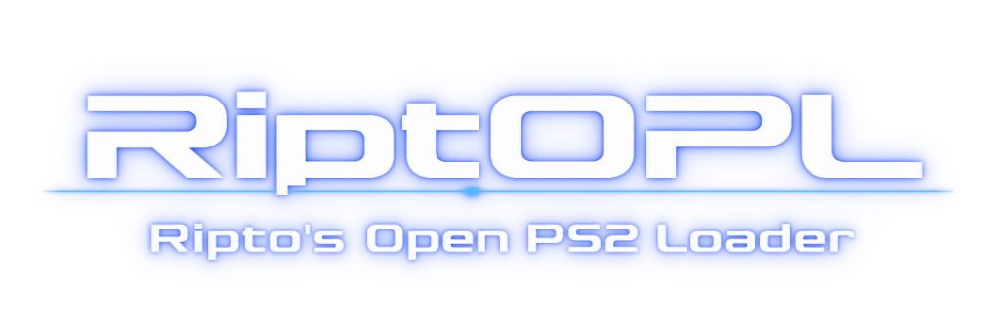

> [!IMPORTANT]
> **This is the legacy version of RiptOPL.** We have moved over to ps2build's **C++ Edition** at
> **[NathanNeurotic/RiptOPL](https://github.com/NathanNeurotic/RiptOPL)**,
> where new development now happens.


<p align="center"></p>

<p align="center">
  
</p>

> **RiptOPL is developed in partnership and collaboration with the [RIPPS2 Project](https://github.com/akilluminati47/RIPPS2) by [Akilluminati47](https://github.com/akilluminati47).**

> **ps2build C++ Edition.** The [C++ Edition](https://github.com/NathanNeurotic/RiptOPL), built with ps2build in collaboration with **[techwritescode](https://git.techwritescode.dev/techwritescode/PSUManager)**, is now the main line of RiptOPL.

## Interface languages

English is built into the ELF. The rolling release also provides **33 external language packs**
(`RIPTOPL-LANGS-*.zip`), though not every recently added RiptOPL-specific string
is localized yet. See the [installation instructions](https://nathanneurotic.github.io/Open-PS2-Loader/languages.html)
for the CWD-first lookup introduced by [#1017](https://github.com/NathanNeurotic/Open-PS2-Loader/pull/1017),
legacy `LNG/` locations and fonts; see the [translation coverage guide](docs/LANGUAGES.md)
to contribute missing strings. CWD support requires a build containing #1017.

## Test builds and save-card recovery

For launch failures, use [Launch diagnostics](docs/LAUNCH-DIAGNOSTICS.md) to identify the
installed package, actual game core, transport and failing stage before changing settings.
Our [fork collaboration review](docs/FORK-COLLABORATION.md) and
[current comparison](https://nathanneurotic.github.io/Open-PS2-Loader/fork-gaps.html)
track shared improvements and candidates from RIPPS2 and other projects with their evidence limits.
The [October 28 fork-gap status](docs/FORK-GAP-STATUS-2026-10-28.md) records parity with the C++
edition, the fixes that landed in both, akilluminati47's RIPPS2 findings and port plan, and what is
still not tested on hardware.

For a supplied PR artifact, follow [Testing a PR or Actions build](docs/TEST-BUILDS.md). For card creation failures, consult [VMC creation and recovery](docs/VMC.md) before deleting or recreating a card containing saves. For build flavours, app placement, Browser/OSDSYS and launch-failure reports, see [Setup questions](docs/SETUP-QUESTIONS.md).

## Community Contributors

A heartfelt thank you to developers who have contributed pull requests directly to this fork. Anyone who opens a pull request against RiptOPL is featured here at the top of the README in recognition of their support for the project and solidarity with its maintainer:

### [@oMrRexD](https://github.com/oMrRexD) (MrRexD)
- **[#795](https://github.com/NathanNeurotic/Open-PS2-Loader/pull/795)** (`fix(sound)`): **MMCE Background Music Recovery** — Made the music decoder recover when SD2PSX/MMCE firmware invalidates its long-lived file descriptor after a failed lookup. Added tracked stream position/size, bounded reopen-and-resume handling for failed reads/seeks, and host coverage for descriptor loss so theme music keeps playing instead of stopping permanently.
- **[#789](https://github.com/NathanNeurotic/Open-PS2-Loader/pull/789)** (`fix(fntsys)`): **Font Lock Concurrency Fix** — Held the font semaphore lock across draw, measure, and load operations in `src/fntsys.c`. This resolved a critical boot-freeze race condition where background font/theme loading on the IO worker thread freed glyph caches and texture atlases while the GUI rendering thread was actively drawing text. Tested across 111 consecutive clean boots on real hardware (SCPH-50001 with SD2PSX and exFAT BDM HDD).
- **[#705](https://github.com/NathanNeurotic/Open-PS2-Loader/pull/705)** (`dialogs`): **RetroAchievements Settings UI** — Restored the RetroAchievements configuration rows to the Network settings dialog page where they are displayed, configured, and persisted.
- **[#704](https://github.com/NathanNeurotic/Open-PS2-Loader/pull/704)** (`RA`): **Menu Network Telemetry Initialization** — Safely initialized and brought the networking stack up from the menu prior to cold telemetry game launches.
- **[#703](https://github.com/NathanNeurotic/Open-PS2-Loader/pull/703)** (`Makefile`): **MMCE DEV9 Integration** — Linked MMCE's CDVD driver with the in-game DEV9 network stack in RetroAchievements builds.
- **[#702](https://github.com/NathanNeurotic/Open-PS2-Loader/pull/702)** (`ee_core`): **EE Core Stack Protection** — Relocated RetroAchievements buffers out of `.bss` to protect the EE stack from memory pressure and instability during game execution.

### [@dnunezx](https://github.com/dnunezx) (darkladark)
- **[#733](https://github.com/NathanNeurotic/Open-PS2-Loader/pull/733)** (`Cover art flow`): **PSBBN Flow** — Contributed LUNA's Collection display and its perspective cover animation. Adapted into a selectable native theme alongside Cover Flow, using RiptOPL's existing game lists, artwork cache, settings and launch callbacks. R3 retains its normal favorite shortcut.

# RiptOPL
**An opinionated [Open PS2 Loader](https://github.com/ps2homebrew/Open-PS2-Loader) fork — aiming to be the "definitive build."**
<br>
Based on Open PS2 Loader · Copyright 2013, Ifcaro & jimmikaelkael<br>
Licensed under Academic Free License version 3.0<br>
Review the LICENSE file for further details.<br><br>

[](https://github.com/NathanNeurotic/Open-PS2-Loader/actions/workflows/flavours.yml)
[](https://github.com/NathanNeurotic/Open-PS2-Loader/actions/workflows/check-format.yml)
[](https://github.com/NathanNeurotic/Open-PS2-Loader/actions/workflows/rolling-release.yml)
[](https://github.com/NathanNeurotic/Open-PS2-Loader/releases)


[](https://mega.nz/folder/74pRHKRB#9SLDkrkvZAbeKO4Qvxg9LQ)

[](LICENSE)


[](https://github.com/NathanNeurotic/Open-PS2-Loader/issues)
[](https://github.com/NathanNeurotic/Open-PS2-Loader/stargazers)


[](https://tinyurl.com/PS2SPACE)
[](https://nathanneurotic.github.io/Open-PS2-Loader/)

> **What is RiptOPL?** A downstream fork of Open PS2 Loader with optional built-in **Coverflow** and **PSBBN Flow** cover-art themes, a **Favorites** tab, per-game **Neutrino** external-core launching, a reorganized category **settings layout**, DualSense support, and configurable defaults. Fresh configurations start with **`<OPL>`**, **4:3**, and **Auto** menu video mode; see [Fresh-start defaults](docs/DEFAULTS.md). Its settings live in their own **`settings_riptopl.cfg`** to keep its master settings separate from official OPL and wOPL. Other files, including network and per-game settings, can still be shared. Favorites import from uOPL/wOPL is **one-way**: the next save writes RiptOPL’s own format to `favourites.bin`. See [Where your files live](#where-your-files-live). See **[This Fork's Additions](#this-forks-additions)**. For the canonical project, use [ps2homebrew/Open-PS2-Loader](https://github.com/ps2homebrew/Open-PS2-Loader).

> 📖 **Full documentation & guides:** **<https://nathanneurotic.github.io/Open-PS2-Loader/>** — searchable setup and reference guides covering storage backends, the Neutrino core, PS1/VCD, the Theme Engine (with worked examples and an annotated sample theme), a full settings reference, and troubleshooting. For Japanese game names with English menus, see [Optional Unicode/CJK font fallback](docs/UNICODE-GAME-TITLES.md) (copy a suitable `font_CJK.ttf` beside `settings_riptopl.cfg` and restart).

> 🌙 **Our #1 recommended alternative: [LUNA](https://github.com/dnunezx/LUNA) by [darkladark](https://github.com/dnunezx).** *Lightweight Unified Neutrino Access* is a visual loader built on NHDDL and Neutrino for **lightweight, customized Neutrino gameplay**. If RiptOPL is more loader than you need, start there. darkladark also contributes to RiptOPL itself; see [Acknowledgements](#acknowledgements).

## Contents

[Documentation index](docs/README.md) · [Releases](#releases) · [Quick Start](#quick-start) · [Sources and cores](#introduction) ·
[Features](#major-features-overview) · [Fork additions](#this-forks-additions) ·
[PS1](#ps1-games-two-cores-one-list) · [HTTP](docs/HTTP.md) · [RetroAchievements](docs/RETROACHIEVEMENTS.md) ·
[Controls & IGR](#controls-and-in-game-reset) · [GSM](docs/GSM.md) · [PADEMU](docs/PADEMU.md) ·
[Interface](docs/INTERFACE.md) · [Japanese/Unicode game titles](docs/UNICODE-GAME-TITLES.md) · [Apps](#apps) · [Files and folders](#how-to-use) · [USB/MMCE/MX4SIO/iLink](#usbmmcemx4sioilink) ·
[SMB](#smb) · [HDD](#hdd) · [Cheats](#cheats) · [NBD](#nbd-server) ·
[ZSO / CSO / CHD](docs/COMPRESSED-IMAGES.md) · [PS3 BC](#ps3-bc) · [Troubleshooting](#frequent-issues) ·
[Companion tools](#external-tools--services) · [Credits](#acknowledgements)

## Releases

Choose a complete install kit for a first installation. Use a loose ELF only to update an
existing installation; it does not update Neutrino, Ember or POPSTARTER support files.

| Channel | Contents and purpose |
| --- | --- |
| [Rolling — inceBtion](https://github.com/NathanNeurotic/Open-PS2-Loader/releases/tag/rolling) | Current standard development build from `rebuild/main`; GitHub Latest. Start with `RIPTOPL-<version>.zip`. |
| [Rolling — Korium](https://github.com/NathanNeurotic/Open-PS2-Loader/releases/tag/rolling-korium) | Standard build with the Korium theme, in `RIPTOPL-Korium-<version>.zip`. |
| [RetroAchievements — both themes](https://github.com/NathanNeurotic/Open-PS2-Loader/releases/tag/rolling-ra) | Experimental RA kits: `RIPTOPL-RetroAchievements-inceBtion-<version>.zip` or `RIPTOPL-RetroAchievements-Korium-<version>.zip`. Read the [RA setup and validation limits](docs/RETROACHIEVEMENTS.md). |
| [Current Fan Favorite](https://github.com/NathanNeurotic/Open-PS2-Loader/releases/tag/current-fan-favorite) | Preserved development snapshot for comparisons; its older package names and feature set can differ. |

These are development builds. A release's title, publication date or GitHub Latest marker does
not establish console compatibility. Check its version, source revision and available assets.

The standard ELF includes GSM, VMC, PS2RD cheats, parental controls and DS3/DS4 PADEMU.
Optional DualSense USB and IGS/RTL builds are in `RIPTOPL-VARIANTS-*.zip` when produced.
The ready app and loose `RIPTOPL.ELF` prefer OFFICIALROLLING; pinned comparison apps are inside
the full kit. Both standard editions install `APP_RIPTOPL`, so switching editions replaces
that app. RA uses the separate `APP_RIPTOPL-RA` name; its two themes replace that same RA app.

[ROLLING_RELEASE.md](ROLLING_RELEASE.md) is the package, build-flavour and publishing reference.
[Installation](https://nathanneurotic.github.io/Open-PS2-Loader/install.html) covers app folders,
PSU imports and companion placement. [Test builds](docs/TEST-BUILDS.md) covers PR artifacts.

## Quick Start

### What you need

- A PS2 with a homebrew ELF launcher, or a supported [backward-compatible PS3](#ps3-bc).
- One prepared storage source from the table below. Ethernet and a reachable server are required for network sources.
- The normal installable `RIPTOPL-<version>.zip` from [Releases](#releases).

### Minimal startup path

1. Extract the normal installable archive. Copy `APPS/APP_RIPTOPL/` to your device's `APPS/` directory, or import `APP_RIPTOPL.psu` with a PS2 save manager to install that app on a memory card. The supplied app uses `-OFFICIALROLLING` when that build is available; the labelled ELF folders provide [other build choices](ROLLING_RELEASE.md#which-build-should-i-use).
2. Copy `ART/` to the device's artwork directory. For Neutrino, copy the complete `neutrino/` folder to `mc0:/neutrino/` or `mc1:/neutrino/`. Install the `POPS/` and `EMBER/` companions for PS1 as described in [PS1 games](#ps1-games-two-cores-one-list). The PSU contains the app files only.
3. Prepare your game's source: `CD/` or `DVD/` for folder-based PS2 libraries, HDLoader partitions for APA, or `games.csv` for HTTP. See [How to use](#how-to-use).
4. In **Settings → Game Sources**, enable the device and its start mode. For a network source, set **Network Connectivity** to **Manual** or **Auto** and pick the **Protocol** under it, then enter your server's settings in **Network**.
5. Use the server's Test action where available, then choose **Save Changes** before launching a game. A successful menu test is not proof that gameplay works.
6. Launch one test game. If it fails, record the exact build, SDK flavour, source and core before changing settings; see [Frequent Issues](#frequent-issues).

### Known limitations

- **HTTP:** implemented and host-tested, but not yet tested on PS2 hardware. ISO only; no VMC, Neutrino or PS1. DVD9 probing is implemented but unproven. [HTTP guide](docs/HTTP.md).
- **RetroAchievements:** a separate development package with limited PS2 telemetry hardware evidence. It supports [xeRAbora v1.0.1](https://github.com/hacan359/xerabora/releases/tag/v1.0.1) (alpha.17 or later) or the Caduceus companion service selected in RA Mode. PS2 telemetry uses OPL-core launches; USB PS1 VCDs through POPStarter use a separate IOP reader and still require console validation. Caduceus adds a paired account/game achievement browser; in-game notices use the pulse by default. Settings > Network offers default-Off Caduceus experimental title/points cards for tracked PS2 OPL launches; they may flicker or freeze games because safe GS ownership is unresolved. Companion PC software is managed separately through PS2-Servers. Physical PS2 disc launches also need hardware validation. Keep tracked games on a local device: upstream reports that games with achievement sets stop loading about a minute into network-share play. [RA guide](docs/RETROACHIEVEMENTS.md).
- **iLink:** revision 2692 passed Ember on the tested SCPH-39001 but failed native OPL, Neutrino and POPSTARTER handoffs. The Neutrino `-qb` correction is implemented, and the i.LINK drivers used by native OPL, the bundled Neutrino and POPSTARTER now keep logging in to the drive after an IOP reset (#1018); a passing retest is still needed.
- **Core switching is source-dependent:** SMB and HTTP use OPL; UDPFS (Files and IMG) and UDPBD default to Neutrino and can use OPL per game. See the [source table](#introduction).

## Introduction

Open PS2 Loader (OPL) is a 100% Open source game and application loader for
the PS2 and supported backward-compatible PS3 units (see [PS3 BC](#ps3-bc)). RiptOPL source is AFL-3.0; bundled third-party components retain their own licences.
Major capabilities include GSM video mode fixes, Virtual Memory Cards (VMC), PS2RD cheats, DS3/DS4 pad emulation, themes, and homebrew app launching.

RiptOPL supports local USB, MMCE, MX4SIO, iLink and internal ATA storage, plus
SMB, UDPFS, UDPBD and HTTP over Ethernet. Capabilities depend on both the source and loader core:

| PS2 game source | Loader core | Image/layout | VMC notes |
| --- | --- | --- | --- |
| USB / MX4SIO / MMCE / ATA exFAT | OPL or Neutrino for ISO | ISO; OPL also handles ZSO and UL split images | Supported; Neutrino cards must be on the game's device |
| iLink | OPL or Neutrino paths implemented | Local files | Launch remains pending hardware retest; see [iLink status](#usbmmcemx4sioilink) |
| Internal HDD, APA | OPL or Neutrino | HDLoader partitions | OPL supports VMC; Neutrino drops APA/PFS VMC with a warning |
| SMB | OPL | ISO, ZSO, UL | Server must permit writes for VMC saves |
| UDPFS Files / IMG and UDPBD | Neutrino (`<OPL>` per game) | Files under `CD/` / `DVD/`, or a served FAT/exFAT disk image | Depends on backend and write access; see [Neutrino](docs/NEUTRINO.md) |
| HTTP | OPL | ISO listed in `games.csv`; compressed images refuse to launch | No VMC; use physical memory cards |

Neutrino does not read local ZSO or UL split images. A compatible UDPFS server can instead
decompress an image on the PC and expose it to the console as an ISO; that is server-side support.
See [ZSO / CSO / CHD setup](docs/COMPRESSED-IMAGES.md) for the source/core table
and the UDPFS Files steps using PS2-Servers.
ELF apps and PS1 games have their own launch paths, described below.

>[!NOTE]
OPL is developed continuously - anyone can contribute improvements to the project due to its open-source nature.

You can visit the Open PS2 Loader forum at:\
<https://www.psx-place.com/forums/open-ps2-loader-opl.77/>

You can report compatibility game problems at:\
<https://www.psx-place.com/threads/open-ps2-loader-game-bug-reports.19401/>

For historical upstream OPL compatibility reports (not a current RiptOPL compatibility guarantee), visit:\
<http://sx.sytes.net/oplcl/games.aspx>

### Major Features Overview

This section is a fast feature map to improve discoverability of core OPL capabilities and reduce setup friction for first-time and returning users.

- **MMCE support:** OPL supports MMCE devices using the Memory Card Mass Storage protocol for SD-based loading through the Memory Card slot.
- **MX4SIO support:** OPL supports MX4SIO adapters for SD-based loading through the Memory Card slot. See the **USB/MMCE/MX4SIO/iLink** section for filesystem and layout guidance.
- **Internal HDD exFAT support:** the internal ATA HDD can be loaded as **exFAT** — mounted through the Block Device Manager (BDMAssault / "BDMA") into the same `massN:` namespace as USB/MX4SIO — in addition to APA/PFS, including GPT partitioning for large disks, for PS2 **and** PS1 (POPSTARTER) games. See the **HDD** section for formatting, the BDMA equip, and fragmentation guidance.
- **Themes:** Fresh configurations start with the built-in **`<OPL>`** theme, **4:3**, and **Auto** menu video mode. The built-in `<OPL>` theme has four views, List, the **Coverflow** carousel, the **PSBBN Flow** perspective fan and the **Grid** of covers: pick one under **Settings → Interface → Theme View** (Coverflow comes as **Coverflow (3)** and **Coverflow (5)**), or hold L3 on the main page to switch. Views and **16:9** are optional choices; apply and save them to keep that presentation. Saved settings override fresh defaults. See [Fresh-start defaults](docs/DEFAULTS.md). Place external theme assets in `THM/`; **UDPFS Files** also reads `udpfs:/THM` once connected (at boot with Network Connectivity **Auto**, or after opening the page with **Manual**). See the [Theme Engine reference](docs/THEME_ENGINE.md) to author themes.
- **Cheats / PS2RD:** OPL supports PS2RD `.cht` cheat files from the `CHT` folder, with both auto-apply and launch-time selection modes.
- **Pad emulation (DS3/DS4):** On any build with PADEMU (the default), a DualShock 3 or DualShock 4 plugged into the console's USB port can navigate the OPL menu right away, with nothing to enable first. To play games with it, turn on **Pad Emulator** under **Settings**, then **Controller Settings** (globally, or per game via **Game Settings**). One caveat: pad emulation shares the SIO2 bus with MX4SIO SD-card loading, so running both can cause a game to hang on a black screen; leave Pad Emulator off if you boot from an MX4SIO card.
- **GSM (video mode handling):** Builds that include GSM allow game video mode handling/overrides for display compatibility.
- **VMC (Virtual Memory Cards):** Create and use VMC images (8MB to 64MB) via the `VMC` folder and per-game options.
  **Create VMC on First Launch** (*Settings → Game Launching*, off by default) does it for you: a PS2 game launched
  with nothing in VMC slot 1 gets an 8 MB card on its own device, named as the VMC screen suggests (so every disc of a
  multi-disc game shares one), assigned and saved before the game starts. An existing card of that name is reused.
  Back during creation cancels the launch. It skips PS1 and app rows, HTTP, and the internal APA HDD under Neutrino
  (which has no VMC); a fragmented new card gets the same warning as the VMC screen.
- **Per-game settings workflow:** Highlight a game, open **Game Settings**, adjust options (such as compatibility modes, cheats, GSM, PADEMU, and VMC), then save so settings persist per title.
- **App launching (APPS + config methods):** OPL can launch homebrew ELFs using either `conf_apps.cfg` entries or per-app `title.cfg` metadata in `APPS` subfolders.

### This Fork's Additions

| Feature | Setup and detailed behavior |
| --- | --- |
| Optional Coverflow, PSBBN Flow and Grid views of `<OPL>` | Select under Interface → Theme View, or hold L3 on the main page. Left/Right browse, Up/Down change sources (in Grid, Up/Down move one row and change sources from the top or bottom row), R3 toggles Favorites. [Theme Engine](docs/THEME_ENGINE.md) includes layout, reflection, animation and per-device placement. |
| Favorites across devices | Enable Favorites under Game Sources; R3 stars a game or app. L3 cycles PS2 → PS1 → ELF → All in One independently of device display modes. [Favorites guide](https://nathanneurotic.github.io/Open-PS2-Loader/favourites.html). |
| External Neutrino core per PS2 game | Complete runtime installation, path aliases, video, cheats, VMC and argument precedence: [Neutrino](docs/NEUTRINO.md). |
| Network libraries | SMB and HTTP use OPL's core; UDPFS Files requires Neutrino; UDPBD and UDPFS IMG default to Neutrino and can use OPL's core per game. Choose Network Connectivity in Game Sources and Protocol on Game Sources or Network. [Network boot](https://nathanneurotic.github.io/Open-PS2-Loader/network-boot.html), [HTTP](docs/HTTP.md). |
| Folder browsing, Apps/PS1ELF split and menu audio | [Interface behavior](docs/INTERFACE.md), [Apps](#apps) and [controls](docs/CONTROLS.md). |
| Artwork archives, disc/logo art and optional 3D save icons | [Theme Engine](docs/THEME_ENGINE.md). Save-icon rendering still requires hardware validation. |
| Fresh-start defaults and separate master settings | Built-in `<OPL>`, 4:3, Auto menu video, artwork/notifications on, audio off. [Defaults](docs/DEFAULTS.md) and [file locations](#where-your-files-live). |
| Per-game parental locks | Password prompts also apply to Favorites and remembered launches. [Parental lock](docs/PARENTAL-LOCK.md). |
| Experimental special hardware | [PC CARD CF](docs/PC-CARD-CF.md) and [PSX DESR DVR](docs/DESR-DVR.md); both opt-in and awaiting console validation. |

<a name="ps1-games-two-cores-one-list"></a>

#### PS1 games — two cores, one list

POPSTARTER `*.VCD` entries and Ember game folders share a PS1 library; the entry determines
the core. **PS2/PS1 Game Display** controls separate, mixed or locked device views. Favorites
and the optional Apps/PS1ELF split keep their own L3 cycles.

Use [the PS1 reference](docs/VCD.md) for the complete folder layout, BIOS/runtime requirements,
Ember global/per-game settings, APA containers, alternate POPSTARTER builds, BDMA selection,
SMB and POPS UDPFS. POPS UDPFS uses Okeanos's separate USB-first driver and valid matching
USB runtime configs; UDPBD and UDPFS IMG remain Ember-only for PS1. iLink POPSTARTER is
wired, and its driver now waits out the drive's post-reset login hold (#1018), but it still awaits a
passing hardware retest. Neutrino and OPL's PS2 core do not launch PS1 rows.

## Controls and In-Game Reset

Use the on-screen **Confirm** and **Back** hints: fresh settings use Circle to confirm,
and the Select Button setting can swap Circle/Cross. Start opens the main menu; Triangle
opens the selected game's menu; R3 toggles Favorites. Flow themes browse horizontally.
The complete [button reference](docs/CONTROLS.md) covers list views, dialogs and boot recovery.

<a name="leaving-a-running-game-in-game-reset"></a>

For native OPL games, hold **L1 + L2 + R1 + R2**, then **Start + Select** to reset, or
**L3 + R3** to power off. IGR resets to OSDSYS unless an IGR Path is configured. It is
unavailable under Neutrino, before the game opens its controller, or with Mode 6 enabled.
PS1 cores have their own reset behavior. [IGR](docs/IGR.md) covers reset targets, USB driver
requirements, the power button and optional screenshots.

<a name="game-list"></a>

For controller emulation use [PADEMU](docs/PADEMU.md); for menu vibration, folders and audio,
use [Interface](docs/INTERFACE.md). Per-game video overrides belong in [GSM](docs/GSM.md)
or the [Neutrino video picker](docs/NEUTRINO.md#video-mode-limits), depending on the core.

## How to use

Folder-based PS2 libraries use the following support folders under their configured library prefix.
APA uses its selected PFS data partition. HTTP uses local support folders beside the active settings
home; it does not open these folders on the server. Availability also depends on the core:

| Folder | Description                                          | Modes       |
| ------ | ---------------------------------------------------- | ----------- |
| `CD`   | for games on CD media - i.e. blue-bottom discs       | All folder devices¹ |
| `DVD`  | for DVD5 and DVD9 images (if filesystem supports +4gb files) | All folder devices¹ |
| `VMC`  | Virtual Memory Card images (headline save feature): stored in `VMC/`, typically 8MB to 64MB, then assigned per game via **Game Settings** | See source/core table |
| `CFG`  | for saving per-game configuration files              | See source/core table |
| `ART`  | for game art images                                  | See source/core table |
| `THM`  | for themes support                                   | See source/core table |
| `LNG`  | for translation support                              | See source/core table |
| `CHT`  | for cheats files                                     | See source/core table |
| `APPS`  | for ELF files                                       | See source/core table |

¹ **Folder-based devices** — USB, MMCE, MX4SIO, iLink, SMB, and the **exFAT** (BDM) HDD — keep games as files in the `CD`/`DVD` folders. The **APA/PFS** HDD instead stores games as HDLoader partitions (no `CD`/`DVD` folders), while still using `CFG`/`ART`/`VMC`/`THM`/`CHT`/`LNG`/`APPS` on the configured OPL data partition (`+OPL` root by default, or `__common/OPL/` for the legacy layout).

Per-game settings are stored per title in the `CFG` context. Typical use cases include compatibility toggles, video options (GSM), cheat toggles, and assigning a VMC file from the `VMC` folder to that game.

RiptOPL attempts to create support folders when you enable a writable source. Read-only sources need preparation on the server or PC; enabling a device does not format a disk or create APA partitions.

For APA, RiptOPL uses existing partitions only: a usable `hdd_partition` selection in
`hdd0:__common/OPL/conf_hdd.cfg`, then an existing `+OPL`, then `__common/OPL/`.
If no suitable data partition exists it fails without creating one. See [HDD](#hdd).

An internal HDD can use GPT partitioning with exFAT to address capacity beyond MBR's conventional 2 TiB limit. exFAT alone does not remove that limit from an MBR disk. See [exFAT storage](docs/EXFAT.md) for setup and driver/hardware limitations.

### Where your files live

`settings_riptopl.cfg` holds RiptOPL's master settings; an older `conf_riptopl.cfg` is imported on
read and migrated on save. The normal settings home starts with the loader's boot directory and
uses discovery/fallbacks when that location cannot be used. **Custom Settings Path** can select a
different home, a memory card included: `mc1:` saves to the card root, and `mc1:/OPL` saves to that
folder, which RiptOPL creates (with its browser icon) on the first save. Check the active location
instead of assuming all settings are on `mc0:/OPL/`.

If a place RiptOPL checks has no RiptOPL settings but does have official OPL's `conf_opl.cfg`,
RiptOPL starts from that file. It is read-only: RiptOPL never writes it, and the next save writes
`settings_riptopl.cfg` to RiptOPL's own settings home. On an APA + exFAT hybrid disk (PSBBN
Definitive's "APA-Jail" layout), a RiptOPL launched from APA uses the exFAT volume as its
settings home, as official OPL does, and starts its BDM page so the exFAT games show. RiptOPL
settings an older build saved in the APA data home are carried over and written to exFAT on the
next save. The menu and Auto Loading use the same settings. See
[docs/AUTOLAUNCH-GLOBAL-SETTINGS.md](docs/AUTOLAUNCH-GLOBAL-SETTINGS.md).

Network configuration (`conf_network.cfg`), app lists, per-game settings, artwork, themes and VMCs
can still be shared with other OPL installations. Separate master filenames do not isolate these
files. Favorites import from uOPL/wOPL is one-way: saving writes RiptOPL's own `OFAV` format.

PS2 folders follow the source's configured library prefix. Local PS1 `POPS/` and `EMBER/` live at
the **device root**, even if PS2 games use a subfolder. APA has its own partition layouts, covered
in [PS1/VCD](docs/VCD.md). HTTP's `CFG/`, `ART/` and `CHT/` are local folders under the active settings
home; placing them on the HTTP server does not make the console load them from there.

## USB/MMCE/MX4SIO/iLink

Supported file systems:
FAT32 and exFAT are the usual folder-based layouts. MBR is the conventional setup for USB and SD media; partition-table support also depends on the device/driver. For large internal disks, see [HDD](#hdd) for GPT/exFAT. This section applies to MMCE and MX4SIO SD setups, USB storage, and iLink SBP2 storage.

> [!WARNING]
> **Revision 2692 iLink status is not a blanket pass.** On an SCPH-39001, Ember passed from the same
> IEEE 1394 disk in all four SDK flavours, while the native OPL core, Neutrino, and POPSTARTER failed
> at their reset/handoff boundaries. The current code corrects a confirmed RiptOPL-side Neutrino
> handoff mismatch (`-qb` was not auto-emitted for iLink); only hardware retesting can establish
> whether that was the complete cause. POPSTARTER's
> external `.ilink` BDMA equip and `mass:/POPS/XX.<name>.ELF` handoff are present, but remain
> unconfirmed. The i.LINK drivers used by native OPL, the bundled Neutrino and POPSTARTER (its
> `.ilink` driver) now retry the drive's login for up to 5 s after an IOP reset instead of giving up
> inside the drive's reconnect hold (#1018), the cause found in the source for all three failures;
> this is not yet confirmed on hardware. See
> [Neutrino](docs/NEUTRINO.md) and [PS1/VCD](docs/VCD.md) for the exact status and isolation checks.

> [!NOTE]
> MX4SIO game launch requires the matching PS2SDK `freesio2` module to load before
> `mx4sio_bd` after OPL resets the game IOP. See [MX4SIO game-launch notes](docs/MX4SIO.md)
> for the dependency, regression history, and hardware test checklist.

Game files should be *ideally* defragmented either file by file or by whole drive.

> Fragmentation has a bounded budget. OPL’s BDM reader shares a 64-entry fragment table across the game image parts; Neutrino’s block-device budget includes the ISO and VMCs together. Contiguous copies leave the most headroom.

If you choose to use the FAT32 file system, games larger than 4gb must use USBExtreme format (see OPLUtil or USBUtil programs).

If a fragment-limit error is reported, first try a fresh sequential copy with enough free space.
Back up all data before considering a reformat; a screen colour alone does not diagnose fragmentation.

## SMB

For loading games by SMB protocol, you need to share a folder (ex: PS2SMB)
on the host machine or NAS device and grant read access for game loading. Write access is also needed for VMC saves and changes to files stored on the share. USB Advance/Extreme format is optional - \*.ISO images
are supported using the folder structure above.

> **SMB version:** the **Network** page has an **SMB Version** row (SMBv1 / SMB2) directly under
> **Protocol**, live only while **Protocol** is **SMB** (greyed out otherwise). It defaults to
> **SMBv1**; setting it to **SMB2** switches *both* sides — browsing loads the SMB2 driver instead
> of the SMBv1 one, and so does the in-game reader — so the server must speak SMB2 for the whole
> session.
>
> **RiptOPL network defaults:** the network protocol selector defaults to **Off** — under
> **Game Sources** set **Network Connectivity** to **Manual** or **Auto** and **Protocol** (under it,
> or on **Network**) to **SMB**, before the **NET Games** tab appears. The Network page
> ships static defaults (PS2 `192.168.1.10`, PC `192.168.1.100`, share `games`, user `guest`);
> adjust them to your LAN. The default **SMB Port is `1111`** — a non-privileged port (>1024), so a server
> binds it without admin/root. The **Network** page opens with **Advanced Options** on, so
> the **Port** field (and ETH link mode) are editable immediately. If Windows 10/11 has
> disabled SMB1/NTLMv1, set **SMB Version** to **SMB2**; the
> **[PS2 Servers](https://github.com/NathanNeurotic/PS2-Servers)** all-in-one launcher remains the
> fallback for SMBv1-only setups. Choose its SMBv1 server, then set RiptOPL's
> IP, port, share and credentials to the values the launcher displays. Its documented custom SMBv1
> port is **1111**, matching RiptOPL’s default. Windows’ built-in server or a NAS may use a different
> port; enter the value that server actually listens on. Release packages
> include **`PS2-Servers.url`** as a direct shortcut to the repository.

## HDD
	
Both PS2 HDD types are **off by default** in RiptOPL — enable the one you use under **Game
Sources**. For PS2, 48-bit LBA internal HDDs are supported. The HDD can be formatted as:

- APA partitioning with PFS filesystem (up to 2TB)
	- RiptOPL mounts an existing data partition. A usable `hdd_partition` selection in `__common/OPL/conf_hdd.cfg` takes priority, followed by existing `+OPL`, then `__common/OPL/`. No partition is created, resized or formatted. `+OPL` uses its root for support folders; `__common` uses `OPL/`.
	- **Table protection:** RiptOPL is a game loader, not a partition manager. It writes only inside PFS partitions (settings, art, VCD and Ember renames) and never to the APA partition table: its driver refuses formatting and creating, deleting or renaming partitions, and raw sector writes. So HDL games can't be deleted or renamed from RiptOPL, and neither can one-game `PP.*` PS1 installs; use a PC tool. If a disk reports **code 402** (or "Formatted: NO" elsewhere), **do not format it** — your games are almost certainly still there. See **[docs/APA-SAFETY.md](docs/APA-SAFETY.md)** and the PC recovery tool in [`pc/apa-recovery`](pc/apa-recovery/README.md).
	- **4Kn drives** (4096-byte *logical* sectors) are refused: every PS2 driver counts in 512-byte sectors. 512e drives (4K physical, 512 logical, nearly every modern disk) work normally.
- MBR partitioning (up to 2TB) or GPT partitioning (capacities above the MBR limit, subject to the driver and tested hardware) with the exFAT filesystem
	- Enable **BDM HDD** in **Game Sources**. The exFAT HDD then mounts through the Block Device Manager (BDMAssault / "BDMA") into the shared `massN:` namespace — the same path as USB/MX4SIO — and appears as an **HDD (exFAT)** games list with the HDD icon.
	- Files should be added contiguously or synchronously to avoid fragmentation. For example, drag and drop files one at a time, or ensure that files are added sequentially.
	- When formatting drives for the exFAT filesystem, please make sure the `Allocation unit size` is set to `Default`.
	- **PS1 games:** PS1 `*.VCD` titles in the HDD's `POPS/` folder list under the **L3** PS1 view like any other device. To boot them, use the BDMA rows on **Settings → PS Emulation Settings**. **VCD BDMA Apply on Launch** is on by default and equips the matching exFAT driver automatically; turn it off to reveal the manual **BDMA Source** / **BDMA Mode** pickers and set **BDMA Mode → HDD (exFAT)** by hand so POPSTARTER can read the exFAT volume. See **[docs/VCD.md](docs/VCD.md)**.

For internal exFAT HDD setup, MBR/GPT choices, large-file benefits, fragmentation and VMC limits, and an empty-game-list checklist, read **[exFAT storage](docs/EXFAT.md)**. APA and exFAT use different game lists; enabling APA is not required for a plain exFAT disk.

## APPS

There are two supported methods for adding apps to OPL. Keep both available and choose the one that fits your setup:

- Use legacy `conf_apps.cfg` when you want one central list and/or apps stored anywhere on supported devices.
- Prefer folder-based `title.cfg` when you want each app self-contained inside `APPS/<APP_FOLDER>/`.

### conf_apps.cfg method (Legacy)

Each entry uses `Display Name=DevicePathToELF`:
- Left side: the name shown in the OPL app list.
- Right side: full device/path to the ELF.

To begin:

1. Create a text file called `conf_apps.cfg`.
2. In this file, put the name you want to appear in the list of apps, followed by the "=" sign.
3. Add the device prefix and ELF path (for example `mass:` for USB/MX4SIO/iLink/exFAT-HDD, `mmce0:` for MMCE, `mc0:` for the Memory Card, or `hdd0:`/`pfs0:` for the APA HDD), then the file path to the ELF.

> NOTE: Enter the exact path and exact letter case. OPL is case-sensitive.

The structure should look like this:

```
My App Name=mass:APPS/MYAPP.ELF
```

let's use OPL itself as an example:

```
OPL=mass:APPS/RIPTOPL.ELF
```

With this method, ELFs do not need to be in `APPS`, but keeping them there can make your setup easier to manage.

RiptOPL checks `mc?:OPL/conf_apps.cfg` first, then `conf_apps.cfg` under each enabled source’s configured prefix; the first file found wins. With a default mass-device prefix, use `mass0:/conf_apps.cfg`. `mass0:/OPL/conf_apps.cfg` is only found through this route when `OPL/` is that source’s configured prefix. Files are not merged into one legacy list.

### title.cfg method

This method uses one `title.cfg` per app folder, with two required lines and one optional one:
- `title=` for the app name shown in OPL.
- `boot=` for the ELF filename to launch, relative to the app's own folder.
- `argv1=` (optional) for a single argument passed to the ELF as its first argument. It shares
  storage with the per-app **Custom ELF** field, so it can also be edited from the console.

To begin:

1. In `APPS`, create a folder for the app.
2. Put the ELF in that folder, and create a text file named `title.cfg` in the same folder.
3. In that file, add the following instructions:

```
title=My App Name
boot=MYAPP.ELF
```

Using OPL again as an example:

```
title=Open PS2 Loader
boot=RIPTOPL.ELF
```

In this method, both the ELF and `title.cfg` must be in the same folder under `APPS`.

> NOTE: In both methods, pay close attention to file names because, as already mentioned, OPL is case-sensitive.

### The REBOOT IOP? prompt

Launching an ordinary app ELF, from Apps or from an app in Favorites, first asks **REBOOT IOP?**:

| Button | Result |
| ------ | ------ |
| **Configured confirm button** (YES) | Reset the IOP before the app starts, so it begins with a freshly reset I/O processor. |
| **Configured back button** (NO) | Start the app on the IOP as RiptOPL left it, with its drivers still loaded. |
| **Triangle** | Cancel and stay in the list. |

To answer it once for good, add `REBOOTIOP=YES` or `REBOOTIOP=NO` to the app's `title.cfg`.
`REBOOT_IOP` also works as the key, and `1`/`0`, `TRUE`/`FALSE` or `ON`/`OFF` as the value; any other
value brings the prompt back. A `conf_apps.cfg` entry reads the same line from its per-app file,
`CFG/<ELF name>.cfg` on an enabled source (for `mass:APPS/MYAPP.ELF`, that is `CFG/MYAPP.ELF.cfg`).
That also applies when `conf_apps.cfg` and a `title.cfg` list the same ELF: RiptOPL keeps the
`conf_apps.cfg` entry, so a `REBOOTIOP` line in `title.cfg` has no effect there.

POPSTARTER launches never ask: `POPSTARTER.ELF` and the `XX.`, `SB.`, `EL.` and `SM.` launcher ELFs
keep their own PS1 launch path. An app on the APA HDD always gets the HDD cleanup before it starts,
whichever answer you give.

## Cheats

OPL accepts `.cht` files in PS2RD format. Name them after the game’s startup ID, for example `CHT/SLUS_123.45.cht`. An uncompressed `CHT/cht.tar` containing `<startup>.cht` members is also supported, with loose files used as a fallback. Each cheat file corresponds to a specific game and must be stored in the `CHT` directory on your device.
Cheats are structured as hexadecimal codes, with proper headers as descriptions to identify their function.
You can activate cheats via OPL's graphical interface. Navigate to a games settings, enable cheats and select the desired mode.

If a game has no cheat file, what happens depends on where cheats were turned on. With cheats on in the **Global Settings** (every game), the game just starts without cheats. With cheats on in that game's **Per-game Settings**, RiptOPL lists where it looked and asks: Accept starts the game without cheats, Back returns to the menu. A cheat file that exists but can't be read always asks: that includes a `cht.tar` member that is empty, over 1 MB or won't parse, and a loose file the device refuses (access denied, or held by another session). A generic I/O error still counts as missing, because an SMB share reports a missing file that way.

### Cheat Modes

  * Auto Select Cheats:  
This mode will enable and apply all cheat codes in your `.cht` file to your game automatically.

  * Select Game Cheats:  
When enabled a cheat selection menu appears when you launch a game. Turn on the cheats you want, then press **Start**. Your picks are **remembered for that game** and shown ticked the next time, matched by cheat name, so a cheat file that gains or reorders cheats keeps them. The first time, only the master code is on. Master codes (`Mastercode`, `Master Code`, `Enable Code (Must Be On)`) are always on and can't be switched off, because every other code needs them. An autolaunch uses the remembered picks without showing the menu.

Cheats work the same way for games launched through **Neutrino**: same settings, same file, same menu. See [Cheats under Neutrino](docs/NEUTRINO.md#cheats-under-neutrino).

## NBD Server

The built-in NBD server **exports the PS2's internal drive to a PC** for tools such as `hdl-dump`
or `pfs-shell`. This is different from UDPBD/UDPFS, which serve game data from a PC to the PS2.
Configure the console's IP (static or DHCP), choose **Start NBD server**, and connect only after
the console reports that it is running. Disconnect the PC client before leaving the server screen.

See the [NBD client setup guide](https://nathanneurotic.github.io/Open-PS2-Loader/nbd.html) for
Linux, WSL and Windows examples. The implementation uses [lwNBD](https://github.com/bignaux/lwNBD)
and the [NBD protocol](https://github.com/NetworkBlockDevice/nbd/blob/master/doc/proto.md).

## ZSO Format

As of version 1.2.0, compressed ISO files in ZSO format is supported by OPL.

To handle ZSO files, a python script (ziso.py) is included in the pc folder of this repository.
It requires Python 3 and the LZ4 library:

  ```sh
pip install lz4
```

To compress an ISO file to ZSO:

  ```sh
python pc/ziso.py -c 2 "input.iso" "output.zso"
```

To decompress a ZSO back to the original ISO:

```sh
python pc/ziso.py -c 0 "input.zso" "output.iso"
```

For OPL-core folder-based sources, copy ZSO files beside your ISOs. Local ZSO is not a Neutrino format, and HTTP refuses compressed-image launches; see the [source table](#introduction).
To install onto internal HDD, you can use the latest version of HDL-Dump.

## PS3 BC

The inherited OPL support targets hardware backward-compatible PS3 models: CECHA/CECHB
(COK-001, EE+GS) and CECHC/CECHE (COK-002/002W, GS with an emulated EE). Use a PS2 ELF
entry point appropriate to that console. USB, SMB and CFW-dependent HDD support are the
inherited paths; current RiptOPL features are not all validated on PS3. See the
[PS3 guide](https://nathanneurotic.github.io/Open-PS2-Loader/ps3-bc.html) for scope and hardware references.

## Some notes for DEVS

Repository helpers live in `tools/`, with CI and documentation helpers in `.github/scripts/`; run them from the repository root. Existing
Makefile targets retain their names and output locations.

Use one of the toolchain images in [the CI workflow](.github/workflows/flavours.yml). Both pinned
and rolling SDK images are supported; the latest SDK is not required. For a reproducible baseline,
use the `PS2DEVPINNED` image: the 2026-07-28 ps2dev pin that `build-rolling-pinned` in
[rolling-release.yml](.github/workflows/rolling-release.yml) builds every `-PS2DEVPINNED` release
asset with. The image carries the toolchain only. The command below repeats that job's steps: it
installs the same host packages, replaces the SDK's `mmceman.irx` and `bdmfs_fatfs.irx` with the
patched builds every release embeds (both scripts download from GitHub), and runs the same serial
`make`. From the repository root with Docker available:

```sh
docker run --rm -v "${PWD}:/src" -w /src ps2dev/ps2dev@sha256:c64ae69c9817865ed98ff054e4ae5360b9e280ed952c97946bca95d9d35be995 sh -c '
  apk add --no-cache bash make git zip unzip tar gzip xz python3 py3-pip py3-yaml gmp mpfr4 mpc1 perl cmake pkgconf coreutils findutils grep sed gawk diffutils &&
  git config --global --add safe.directory "*" &&
  sh .github/scripts/install_coherent_mmce.sh &&
  python3 .github/scripts/install_safe_bdmfs.py &&
  make clean && make LOCALVERSION=PS2DEVPINNED release'
```

The iLink driver job (`popstarter-ilink-driver` in flavours.yml) builds in a different ps2dev pin,
taken 2026-08-13 (`sha256:8fba50ec…`), because it must reproduce the checked-in
`usbhdfsd.irx.ilink` bytes exactly (see `modules/bdmassault/PROVENANCE.md`). That pin is not
`PS2DEVPINNED`; do not compare its builds with `-PS2DEVPINNED` release assets.

Use a clean checkout/build directory when changing SDK images. See the Makefile for flags such as
`DUALSENSE=1` and `EXTRA_FEATURES=1`; build success does not establish console compatibility.

`src/xparam.c` holds a hardcoded table of special disc titles whose EE parameters are taken from
`SYSTEM.CNF`. It is applied automatically and has no setting, dialog row or language string — it is
deliberately internal and is not user-facing documentation.

## OPL Archive

Successful archive uploads preserve rolling builds on MEGA under run-specific folders (`RiptOPL/Rolling/<version>/run_<number>/`). Uploads depend on publishing success and configured credentials; superseded or failed runs may have no archive. The archive includes installable packages, source and build metadata; VARIANTS and DEBUG bundles are excluded. You can access it by clicking the MEGA badge at the top of this readme or visiting the [MEGA Rolling Archive](https://mega.nz/folder/74pRHKRB#9SLDkrkvZAbeKO4Qvxg9LQ).

## Frequent Issues

### OPL freezes on logo or grey screen

Hold **START** while RiptOPL initializes to skip saved configuration. If that restores the menu,
review the active settings location, configure the required source, save, and retry a normal boot.
This isolates configuration as a possibility; it does not diagnose every startup freeze.

### Game freezes on white screen

A white or black launch screen alone does not identify the cause. Record the exact build/SDK,
console, game ID, source and core. Check the image against a known-good dump and test with game
overrides disabled. If the loader reports a fragment-limit error, try a fresh sequential copy.
Back up the device before any reformat; do not reformat solely because of the screen colour.

### OPL does not display anything on boot

Hold **Triangle + Cross** while RiptOPL initializes to force **480p for the OPL menu**. Your display
and connection must accept 480p. On a TV that only takes interlaced signals (a CRT, for example),
hold **Triangle + Circle** instead: it forces **Auto**, the region's interlaced mode. Once visible,
choose a suitable menu mode under **Interface** and save. **START** skips saved configuration and
uses defaults if you need to undo a saved menu setup.

When you change the video mode, keeping it takes a **hold** of Accept (about 2 seconds, until the bar
fills). A tap does nothing, and Back or 10 seconds without an answer restores the previous mode, so a
mode your TV can't show can't be kept by pressing buttons blind. The prompt counts those seconds down;
holding Accept hides the count but doesn't stop it, so a hold you started always finishes, while letting
go early after the time is up goes straight back.

### The internal HDD shows code 402, or "Formatted: NO" in another tool

The drive answered, but its APA partition table can't be read. This is almost always the table's
first sectors only — every partition, and every game, is normally still on the disk. **Do not
format or initialize it.** Connect it to a PC and follow **[docs/APA-SAFETY.md](docs/APA-SAFETY.md)**,
which uses [`pc/apa-recovery/apa_recover.py`](pc/apa-recovery/README.md) to check and, when safe,
rebuild just that table.

### A drive shows code 500 and never appears

The drive uses 4K (4096-byte) *logical* sectors. Every PS2 storage driver counts in 512-byte
sectors, so RiptOPL refuses such drives on purpose rather than risk reading or writing the wrong
data; this will not change. It mostly affects large desktop external drives whose enclosures present
4K sectors. The same drive in a generic enclosure usually presents 512-byte sectors, but it must be
**reformatted** after the move. A drive that is 4K natively (4Kn) stays 4K in any enclosure. Ordinary
512e drives (4K physical, 512 logical) are not affected.

### A USB / MX4SIO / exFAT page lists no PS2 games

If RiptOPL says *Could not open the CD or DVD folder in mass0: (error 5)*, neither folder would open at
the path it names (the device plus your BDM Prefix Path, if set). Error 5 is an I/O error (check the
device on a PC), 2 means the folder is missing and couldn't be created, 13 is access denied. An empty
folder never shows this: RiptOPL creates `CD` and `DVD` itself and simply lists nothing. It scans once
and does not retry in the background; press **Select** on that page to scan again. Details:
[Troubleshooting](https://nathanneurotic.github.io/Open-PS2-Loader/troubleshooting.html#ps2-folders-unreadable).

### The menu works, but launching a game loses the picture

Menu recovery does not clear game video settings. Open that game’s settings and disable/change its
GSM override, or its Neutrino video options if that is the selected core. Check inherited global
video defaults too. Retry with the game's normal video mode before adding overrides again.

Report RiptOPL regressions in [this repository’s issue tracker](https://github.com/NathanNeurotic/Open-PS2-Loader/issues).
Include the version/SHA, SDK flavour, console model, game ID, storage/protocol, loader core,
reproduction steps, relevant settings and any known-good build comparison. For upstream/community
discussion, the [OPL forum](https://www.psx-place.com/forums/open-ps2-loader-opl.77/) remains available.

## External Tools & Services

RiptOPL is intended to work with these maintained companion tools:

- **[PS2-Servers](https://github.com/NathanNeurotic/PS2-Servers)** by **[Ripto](https://github.com/NathanNeurotic)** — all-in-one PC server launcher for **SMB, UDPFS, UDPBD and HTTP**.
- **[udpfs-server](https://github.com/YouKnow-sys/udpfs-server)** by **[YouKnow-sys](https://github.com/YouKnow-sys)** — the same idea **from a phone**: an Android app that shares folders and disk images to the PS2 over **UDPFS**, found by broadcast so there is no server address to type in on the console. Works over a router or a direct cable. Built on **[udpfsd](https://github.com/pcm720/udpfsd)** by **[pcm720](https://github.com/pcm720)**; MIT licensed. An `android-udpfs-server.url` shortcut ships in installable packages.
- **[OrbitPS2 Manager](https://github.com/Luden02/OrbitPS2-Manager)** by **[Luden](https://github.com/Luden02)** — cross-platform PC library manager for importing discs, artwork/screenshots, ZSO compression, per-game settings and VMC management.
- **[LUNA](https://github.com/dnunezx/LUNA)** by **[darkladark](https://github.com/dnunezx)** — *Lightweight Unified Neutrino Access*, a visual PS2 loader built on NHDDL and Neutrino, and our **#1 recommended alternative** if RiptOPL is more loader than you need. darkladark also contributes to RiptOPL: the PSBBN Flow theme adapts LUNA's Collection display (#733, superseded by #977), preserving the normal R3 favorite action.
- **[RIPPS2](https://github.com/akilluminati47/RIPPS2)** by **Akilluminati47** — a PS2-inspired front end developed in collaboration with RiptOPL, with a **web-theme beta** at **[akilluminati47.github.io/RIPPS2](https://akilluminati47.github.io/RIPPS2/)**. It now offers a downloadable PS2 ELF; consult its own releases and compatibility notes for current builds.
- **[OPL PS1 AIO Converter GUI](https://github.com/shaanhomebrew-cloud/OPL-PS1-AIO-Converter-GUI)** by **[shaan](https://github.com/shaanhomebrew-cloud)** — Windows all-in-one PS1/POPStarter preparation tool for converting BIN/CUE backups to VCDs and installing them to USB, MX4SIO, MMCE, iLink, exFAT HDD, SMB and APA internal HDD.
- **[xeRAbora](https://github.com/hacan359/xerabora)** by **[hacan359](https://github.com/hacan359)** — the PC client for **RetroAchievements** on real PS2 hardware. Recommended client: **[v1.0.1](https://github.com/hacan359/xerabora/releases/tag/v1.0.1)** (alpha.17 or later). RiptOPL's RA build supports **xeRAbora v1.0.1** (alpha.17 or later) and its snapshot-only Mode 6 behavior. xeRAbora runs rcheevos, talks to the RetroAchievements servers and unlocks the achievements. It also builds the per-game watch list the console needs. Shipped as a shortcut inside `RIPTOPL-RetroAchievements-*.zip`; MIT licensed. RiptOPL’s RA stabilization on real hardware was driven by **[oMrRexD](https://github.com/oMrRexD)**, whose PRs #702–#705 fixed the ee_core stack squeeze, MMCE DEV9 path, cold-launch networking and settings placement.
- **[OPL HTTP PC server](https://github.com/Docmine17/Open-PS2-Loader-HTTP)** by **[Docmine17](https://github.com/Docmine17)** — the PC side of RiptOPL’s **HTTP** protocol: a small static HTTP server with byte-range support that serves your `games.csv` catalog and streams the ISOs themselves. RiptOPL works with it **unmodified** — no new API, no catalog conversion, no changed folder layout — with host conformance checks against the upstream server. PS2 hardware validation is still pending.
- **[PS2RD CHT Manager](https://github.com/TheRealNextria/PS2RD-CHT-Manager)** by **[TheRealNextria](https://github.com/TheRealNextria)** — PC manager for the PS2RD `.cht` cheat files RiptOPL reads from your device's `CHT` folder. A `PS2RD-CHT-Manager.url` shortcut ships in installable packages.
- **[Ember](https://github.com/Gageformer/Ember)** by **[Gageformer](https://github.com/Gageformer)** — a PS1 emulator that runs natively on the PS2, used as RiptOPL's **second PS1 core** alongside POPSTARTER. Unlike the others this one is not just a shortcut: an `EMBER/` folder ships **inside** the release package, ready to drop onto a device. It is bundled unmodified under the Ember Public Beta Testing Licence (`EMBER/LICENSE-BETA.txt` in the package); releases: <https://github.com/Gageformer/Ember/releases>.
- **[BDM-UDPFS Assault](https://github.com/Okeanos86/BDMAssault/releases)** by **[Okeanos](https://github.com/Okeanos86)** — POPSTARTER-specific BDMA drivers with read-only UDPFS fallback for VCDs, based on israpps' BDM Assault.
- **[POPStarter](https://www.psx-place.com/resources/popstarter.683/)** by **krHACKen** — a PS1 launcher built around Sony's native **POPS** emulator for the PS2, used as RiptOPL's **primary PS1 core** alongside Ember. POPStarter provides the compatibility and launch layer for running PS1 VCDs from USB, MX4SIO, MMCE, iLink, internal HDD, and SMB; RiptOPL's iLink handoff is wired but still awaiting a passing hardware retest. The official POPStarter r13 package contains **no Sony emulator binaries, libraries, or BIOS files**; those components must be supplied separately by the user. Official download, documentation, compatibility information, and releases are maintained on **[PSX-Place](https://www.psx-place.com/resources/popstarter.683/)**.
- **[ORBIT Neutrino RA runtime](https://github.com/danielnuld/ps2-launcher/releases/tag/v1.0.2)** by **[Daniel (danielnuld)](https://github.com/danielnuld)** — the existing RA-capable Neutrino runtime, bundled only in the RetroAchievements kit. Based on Neutrino by Maximus32 and xeRAbora protocol work by hacan359; AFL-3.0. The exact release, archive digest and source commit ship in `neutrino/ORBIT-RA.json`. Standard kits retain ordinary upstream Neutrino.
- **[Neutrino](https://github.com/rickgaiser/neutrino)** by **[rickgaiser](https://github.com/rickgaiser)** — a *"Small, Fast and Modular PS2 Device Emulator"*, and RiptOPL's **second PS2 loader core** alongside OPL's own. Like Ember it is not a shortcut: a ready-to-use `neutrino/` folder ships **inside** each installable ZIP, drag-and-drop to `mc?:/neutrino/`. Neutrino is deliberately **UI-agnostic** — it has no interface of its own, which is exactly what lets a front-end like RiptOPL drive it per game. Licensed **AFL-3.0**; releases: <https://github.com/rickgaiser/neutrino/releases>.
- **[PSUManager](https://git.techwritescode.dev/techwritescode/PSUManager)** by **techwritescode** — the CC0 PS2 save-container implementation used by RiptOPL release tooling to independently validate `APP_RIPTOPL.psu` and `APP_RIPTOPL-RA.psu`. The exact upstream core and license used by CI are preserved in `third_party/PSUManager/`.
## Acknowledgements

This fork stands entirely on the shoulders of the PS2 homebrew community. **None of this
would exist without the [ps2homebrew](https://github.com/ps2homebrew) team** and their many
years of open-source work on Open PS2 Loader and the PS2SDK — kept free, open, and readable
so that people like us can study it, learn from it, and build on it. Every feature in this
fork began as *their* code and *their* ideas. We are deeply grateful that this work was
shared openly; it is the only reason a fork like this is even possible.

RiptOPL is a **direct agglomeration** of the wider OPL family, bringing together features, code,
and ideas from [rickgaiser's OPL](https://github.com/rickgaiser/Open-PS2-Loader),
[neutrino](https://github.com/rickgaiser/neutrino),
[sOPL](https://github.com/mystyq/Stable-Open-PS2-Loader), uOPL,
wOPL (historical; its public repository is unavailable), [OPL DB](https://github.com/Jay-Jay-OPL/OPL-Daily-Builds),
[POPSLoader](https://github.com/NathanNeurotic/POPSLoader),
[OPL RetroGEM ID by CosmicScale](https://github.com/CosmicScale/Open-PS2-Loader-Retro-GEM),
[nhddl](https://github.com/pcm720/nhddl),
[hacan359's RetroAchievements OPL](https://github.com/hacan359/Open-PS2-Loader/pull/1),
[Modulo-R1](https://github.com/AdityaKumar7209/Modulo-R1-Beta-Preview---PS2),
[PS2-Launcher](https://github.com/Irfanlesnar/PS2-Launcher),
[official OPL](https://github.com/ps2homebrew/Open-PS2-Loader), and
[YAOPL by belomaxorka](https://github.com/yaopl/yaopl).

With special and sincere thanks to:

- **[belomaxorka](https://github.com/belomaxorka)** — for building
  **[YAOPL (Yet Another Open PS2 Loader)](https://github.com/yaopl/yaopl)** and
  contributing extensive backend compatibility, reliability, and safety fixes
  throughout the OPL ecosystem. His work on controller handoff, MMCE, UDPBD/USB,
  ISO/ZSO parsing, game loading, and reproducible regression cases is an
  important reference for RiptOPL development. Thank you for sharing this work.

- **KrahJohlito** — the legend, and the single biggest influence on this fork. Creator of
  **uOPL (Unofficial Open PS2 Loader)** and its continuation
  **wOPL** (historical; its public repository is unavailable), where the modern OPL experience was
  invented. The Neutrino external-core loader, the Coverflow interface, and the Favorites
  tab — the features that define RiptOPL — were designed and pioneered by him, and everything
  this fork does with them is a reimplementation of his work. We learned more reading his
  code than anywhere else, and RiptOPL is, above all, a tribute to it. Thank you.
- **Wolf3s** — for contributions across the wOPL effort and the wider OPL scene, and for
  past work on an independent **uOPL** fork that kept
  unique features and unmerged work alive. Thank you.
- **bbsan2k** — for the **MMCE (Memory Card Mass Storage) protocol** that makes SD-via-memory-card
  loading through the PS2's memory-card slot possible. OPL's MMCE support builds directly on it.
- **hacan359 (yoba)** — for **RetroAchievements on real PS2 hardware** and the
  **[xeRAbora PC client (v1.0.1)](https://github.com/hacan359/xerabora/releases/tag/v1.0.1)** (MIT). The console identifies the
  game and streams the memory addresses its achievements watch; xeRAbora handles rcheevos, the
  RetroAchievements service, and login. RiptOPL implements the published wire protocol in its
  `RIPTOPL-RetroAchievements-*.zip` build, which includes a shortcut to xeRAbora.
- **[oMrRexD](https://github.com/oMrRexD)** — for the decisive **real-hardware RetroAchievements
  stabilization pass** behind PRs #702–#705: tracing the ee_core stack corruption, restoring MMCE's
  in-game DEV9 dependency, making cold telemetry launches bring networking up safely, and putting
  the RA controls back where they are actually read and saved. The fixes were narrow, well-tested,
  and explicitly kept from contaminating normal build behavior.
- **[darkladark](https://github.com/dnunezx)** — creator of **[LUNA](https://github.com/dnunezx/LUNA)**
  (*Lightweight Unified Neutrino Access*), his own visual loader built on NHDDL and Neutrino, with a
  PS2-inspired glass interface and four switchable library views. LUNA is **our #1 recommended
  alternative to RiptOPL** for lightweight, customized Neutrino gameplay. He also contributes to
  RiptOPL directly: his [#733](https://github.com/NathanNeurotic/Open-PS2-Loader/pull/733) contributed
  LUNA's Collection display, adapted as the native **PSBBN Flow** theme in
  [#977](https://github.com/NathanNeurotic/Open-PS2-Loader/pull/977) with the normal R3 favorite action. Thank you for sharing your work with us.
- **[Okeanos](https://github.com/Okeanos86)** — for **[UDPFS Assault](https://github.com/Okeanos86/BDMAssault/releases)** (TEST 2026-10-28), giving POPSTARTER network read/write over UDPFS through BDMA, based on israpps’ BDM Assault.
- **saildot4k** — for **BDMA-ATA** (exFAT internal-HDD block-device support), and the fixes,
  feedback, and oversight that shaped this fork's block-device work. A big piece of getting it right.
- **[techwritescode](https://git.techwritescode.dev/techwritescode/PSUManager)** — for
  **PSUManager**, whose CC0 core documents the PS2 save container format and independently
  validates the `APP_RIPTOPL.psu` and `APP_RIPTOPL-RA.psu` release saves. Its unmodified
  core and license are preserved in [third_party/PSUManager](third_party/PSUManager/README.md).
- **eliminator1403** — for dedicated **testing, bug reports, and real-hardware feedback** that
  has repeatedly caught issues and shaped fixes across this fork. Invaluable QA.
- **Berion** — for the artwork and theme design that has shaped how OPL *looks* for years.
  The visual language this fork builds on owes a great deal to that craft.
- **AdityaKumar7209** — whose [**Modulo-R1**](https://github.com/AdityaKumar7209/Modulo-R1-Beta-Preview---PS2)
  project inspired this fork's **folder browsing** in the game list.
- **Irfanlesnar** — creator of [**PS2-Launcher**](https://github.com/Irfanlesnar/PS2-Launcher),
  for UI, feature ideas, and contributions across the OPL fork ecosystem.
- **Ifcaro** and **jimmikaelkael** — the original Open PS2 Loader authors — and every
  contributor across OPL's long history.

### The wider Open PS2 Loader team

RiptOPL inherits the work of everyone who built Open PS2 Loader over the years. They are
credited in full in [CREDITS](CREDITS), and named here so this fork never obscures whose
work it is built on:

- **Core developers** — Ifcaro, volca, jimmikaelkael, polo35, izdubar, hominem.te.esse and
  SP193, with the original main code based on **Polo**'s HD Project.
- **Contributing developers** — BatRastard, crazyc, dlanor, doctorxyz, reprep, belek666,
  Maximus32 and misfire.
- **Module authors** — **Eugene Plotnikov** (SMSUTILS / SMSMAP / SMSTCPIP), **Marcus R. Brown**
  (DEV9 / ATAD and the derived cdvdman code), **bbsan2k** (MMCE), **icyson55** (OPL-CL /
  network update), **Eric Young** (the DES algorithm in the SMB code), and the **ps2dev** team
  (USB / Network / PS2HDD modules from the PS2SDK).
- **CI/CD** — **fjtrujy** (Docker + GitHub Actions).
- **UI & artwork** — **Berion**.
- **Quality assurance** — RandQalan, yoshi314, EP, LocalH, lee4, El_Patas, ShaolinAssassin,
  algol, gledson999, jolek and zero35.

### Real-hardware testing (this fork)

- **Aerosol** — isolated a UDPFS connection setup issue and confirmed that CRLF config output
  could leave a carriage return in a VMC filename; converting the config to LF restored VMC loading.

Enormous thanks to the testers who run rolling builds on real consoles and file the
reports that shape the fixes — **eliminator1403, lucaslmgv, AndrewBento, AcidReach, bodvenomz,
nuno6573, zackcage6, Blade1984, Vapor, V3ditata and Aislinn🏳️‍⚧️**.

### The name (this fork)

**RiptOPL is named by [Akilluminati47](https://github.com/akilluminati47)** — he came up with it
before the project existed, and it stuck. Every release, every build, every thread carries a name
he thought of first.

### Financial support (this fork)

Heartfelt thanks to **Akilluminati47** for generously **funding this fork's development** — a
kindness that keeps the rolling builds coming and is deeply appreciated.

If you want the canonical, actively-maintained project, it lives at
**[ps2homebrew/Open-PS2-Loader](https://github.com/ps2homebrew/Open-PS2-Loader)** — please
support it. This fork is a downstream labor of love, not a replacement, and it exists only
because that upstream work is open for everyone to learn from.

Experimental early-model PC CARD CompactFlash support and opt-in DESR DVR discovery: see [hardware requirements and limits](docs/PC-CARD-CF.md). Both source toggles default to off; RiptOPL console acceptance remains outstanding. CF driver credit: mihhru / PS2CF.
